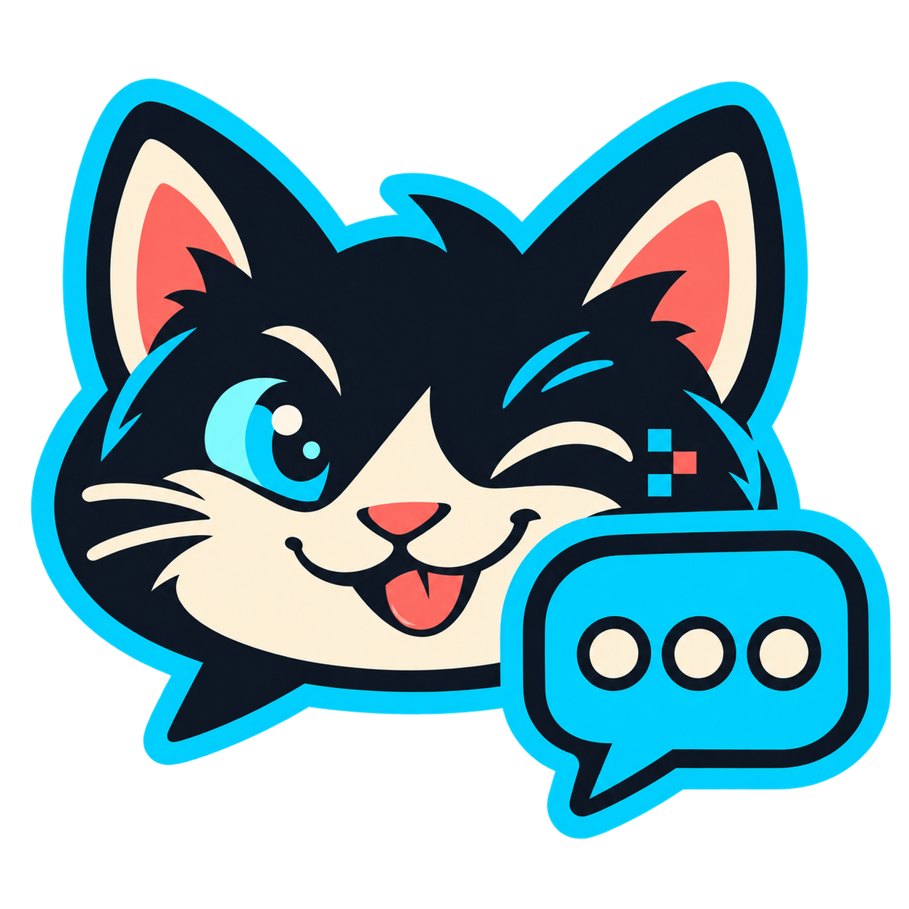

<p align="center"></p>

# Cat Chat

Secret messages. Actual lolcats.

Cat Chat encrypts a message, hides it in a cat PNG using least-significant-bit steganography, and sends the original image through a small relay. The recipient sees two panels: the decoded message and its lolcat carrier.

## Current features

- Windows and Linux Python desktop client with dark mode and a light/dark toggle.
- Image selector and Random Cat.
- AES-256-GCM encryption, scrypt password derivation, and RGB LSB PNG encoding.
- PNG import/export and offline preview.
- Lightweight Python/SQLite relay with an optional shared access token for localhost and a required token when binding publicly.
- Original Cat Chat logo and Windows icon.

Android is planned; no Android application is included yet. Linux execution is not yet verified. This is an experimental prototype, not an audited secure messenger.

## Run the desktop app

Use Python 3.11 or newer, with Tk installed.

```
python -m pip install -r requirements.txt
python tools/download_cats.py
python cat_chat.py
```

On Ubuntu/Debian install `python3-tk` and `python3-venv`, then use `sh run-linux.sh` after downloading the image library. The first launch installs dependencies into a local virtual environment. You can download the library with `.venv/bin/python tools/download_cats.py` once that environment is installed, or use a separately installed Python with Pillow.

Enter a shared message secret, type a message, and click **Local preview** to test without a server.

## Image library

The local prototype uses 25 captioned cat memes from I Can Has Cheezburger. Those third-party images have no blanket redistribution license, so their image files and image-containing executables are not published in this repository. `CAT_SOURCES.json` records the source URLs; the optional download tool retrieves a local library for your prototype. Rights remain with the original creators. Use images you have permission to redistribute for a public release. You can also put your own PNGs in `real-cats/`.

## Chat between two clients

```
python relay.py
```

Open two clients. Both use `http://127.0.0.1:8787`, the same room, and the same message secret. Connect, then **Send Cat**. If a relay access token is configured, enter it in both clients. Messages are polled every two seconds. Disconnect before changing room or secret.

For hosting, see [RELAY_SETUP.md](RELAY_SETUP.md). Internet connections need HTTPS through a separately configured proxy. The relay uses one shared token for trusted participants; it does not implement individual accounts or private room authorization. Images expire after 24 hours, with cleanup on requests.

## Windows packaging

```
python -m pip install pyinstaller
python -m PyInstaller --noconfirm --onefile --windowed --name CatChat --icon assets/catchat.ico --add-data "real-cats;real-cats" --add-data "assets;assets" cat_chat.py
```

The executable appears in `dist/`. Download or supply a local library first. The semicolon syntax above is for Windows.

## Tests

```
python -m unittest discover -s tests
```

## Carrier format v1

RGB channels in row-major pixel order; one least-significant bit per channel. Write bytes most-significant bit first. Header: ASCII `CAT1`, then a four-byte big-endian payload length. Payload: 16-byte random salt, 12-byte nonce, AES-GCM ciphertext and its 16-byte tag. Scrypt uses UTF-8 password, N=16384, r=8, p=1, and a 32-byte output. AES-GCM associated data is ASCII `CAT1`; plaintext is UTF-8. Save as a lossless PNG.

LSB is detectable, and resizing, compression, or editing can break extraction. Use strong separately shared secrets. The prototype does not provide forward secrecy or verified identities.

## Project status and rights

Source and logo are published for inspection and collaboration. No open-source license has been selected yet; public visibility does not grant a blanket reuse license. Third-party libraries retain their own licenses, and meme images retain their creators' rights.
